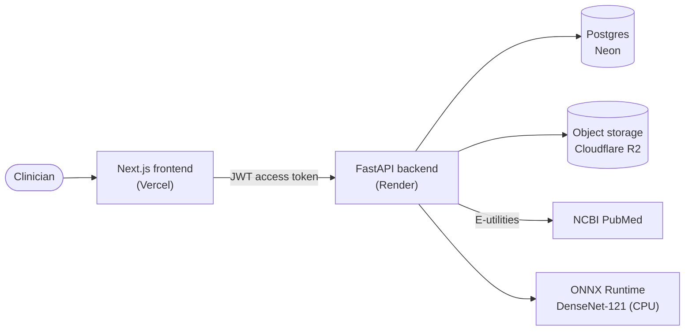

# MedVision AI — Web

Chest X-ray decision support, built to show **what the model sees and the evidence behind it**. Upload a frontal chest radiograph and MedVision returns per-finding predictions with confidence, a GradCAM heatmap of where each finding is grounded in the image, and cited peer-reviewed literature for every finding — with a clinician always in the loop.

> **Research / educational prototype — not a diagnostic tool.** Outputs are not a substitute for evaluation by a qualified clinician. All data is public or synthetic.

**Live demo:** https://medvision-cxr.vercel.app &nbsp;·&nbsp; **Backend API:** [`medvision-api`](https://github.com/justmic007/medvision-api)

This repository is the **frontend** (Next.js). The model, inference, storage, and data live in the backend repo above.

---

## Contents

- [Features](#features)
- [How it works](#how-it-works)
- [Architecture](#architecture)
- [Tech stack](#tech-stack)
- [Getting started](#getting-started)
- [Routes](#routes)
- [Project structure](#project-structure)
- [Authentication](#authentication)
- [Design decisions](#design-decisions)
- [Deployment](#deployment)
- [Screenshots](#screenshots)
- [Roadmap](#roadmap)
- [License](#license)

---

## Features

- **One-click demo** — explore as a clinician or admin with no sign-up (synthetic accounts, synthetic data only).
- **Analysis** — upload a frontal chest X-ray (PNG/JPG) and get predictions across 18 findings, each with a confidence score shown against the model's 50% operating point.
- **Visual explainability** — GradCAM heatmaps show where the model is looking for the most salient findings.
- **Evidence grounding** — every finding links cited PubMed literature.
- **Patients & cases** — register patients, save an analysis as a case, and review it later; original scans kept in object storage.
- **Role-based access** — clinician and admin roles, with an admin approval lifecycle for new clinicians.
- **Secure auth** — JWT access token held in memory plus a refresh token in an httpOnly cookie.

## How it works

A single analysis flows through the system like this:

1. A clinician uploads a frontal chest X-ray on `/analyze`.
2. The frontend sends the image to the backend `/analyze` endpoint with the access token.
3. The backend **preprocesses** the image, runs **ONNX inference** (TorchXRayVision DenseNet-121, 18 findings), computes **GradCAM** heatmaps for the most salient findings, and retrieves **cited PubMed literature** per finding.
4. If a patient is selected, the scan is stored in object storage and the case is persisted to the database.
5. The frontend renders the results: confidence bars against the 50% operating point, heatmap overlays, and the cited literature.

Saved cases can be revisited at `/cases/[id]`, where they render with the same confidence-bar UI as a live analysis.

## Architecture



The frontend is a stateless Next.js app; all model, data, and storage concerns live behind the backend API. The only thing the frontend needs to know about the backend is its base URL (`NEXT_PUBLIC_API_URL`).

## Tech stack

- **Framework:** Next.js 16 (App Router) + React 19, TypeScript
- **Styling:** Tailwind CSS v4, shadcn/ui (on Base UI primitives), lucide-react icons
- **Data fetching:** TanStack Query
- **Forms & validation:** React Hook Form + Zod
- **Package manager:** Yarn (Classic)

## Getting started

### Prerequisites

- Node.js 20+
- Yarn
- A running [`medvision-api`](https://github.com/justmic007/medvision-api) backend (local or deployed)

### Setup

```bash
# install dependencies
yarn

# point the app at your backend
echo "NEXT_PUBLIC_API_URL=http://localhost:8000" > .env.local

# start the dev server
yarn dev
```

Open http://localhost:3000. Sample chest X-rays for trying the analyze flow live in [`test-images/`](./test-images).

### Scripts

| Command | Description |
| --- | --- |
| `yarn dev` | Start the development server |
| `yarn build` | Create a production build |
| `yarn start` | Serve the production build |
| `yarn lint` | Run ESLint |

### Environment

| Variable | Description | Example |
| --- | --- | --- |
| `NEXT_PUBLIC_API_URL` | Base URL of the backend API | `http://localhost:8000` |

## Routes

| Route | Purpose | Access |
| --- | --- | --- |
| `/` | Landing page + one-click demo | Public |
| `/login`, `/register` | Sign in / request an account | Public |
| `/dashboard` | Signed-in home | Clinician · Admin |
| `/analyze` | Upload and analyze a chest X-ray | Clinician |
| `/patients`, `/patients/new`, `/patients/[id]` | Patient list, create, and detail | Clinician |
| `/cases/[id]` | Saved case detail | Clinician |
| `/admin` | Clinician approval and administration | Admin |

## Project structure

```
app/
  page.tsx            # Landing + one-click demo
  login/ register/    # Authentication
  dashboard/          # Signed-in home
  analyze/            # Upload & analyze a chest X-ray
  patients/           # List, new, and [id] detail
  cases/[id]/         # Saved case detail
  admin/              # Admin / clinician approval
  layout.tsx          # Root layout
  providers.tsx       # TanStack Query provider
  warmup-ping.tsx     # Wakes the backend on app load
components/           # Reusable UI (shadcn / Base UI)
lib/                  # API client, auth context, helpers
types/                # Shared TypeScript types
public/               # Static assets
test-images/          # Sample chest X-rays
```

## Authentication

New clinicians go through **register → email verification → admin approval → login**. Admins manage approvals from `/admin`.

The token handling is designed to limit XSS exposure:

- On login, the backend sets a **refresh token** in an **httpOnly, Secure, `SameSite=None`** cookie (cross-origin between Vercel and Render).
- The short-lived **access token** is kept **in memory** (not `localStorage`) and attached to API requests.
- When the access token expires, the client silently refreshes it using the cookie.
- Pages are guarded by a role-aware `Protected` wrapper, so clinician and admin routes redirect unauthenticated or unauthorized visitors to login.

## Design decisions

- **Access token in memory + refresh in an httpOnly cookie** — avoids storing tokens in `localStorage`, reducing XSS risk.
- **Confidence against a 50% operating point** — TorchXRayVision normalizes each pathology's output so its operating point maps to 0.5, so a finding is shown as present when confidence ≥ 50%. The UI marks that point on every bar.
- **CPU-only ONNX inference on the backend** — keeps the whole system deployable on free tiers (no GPU required).
- **Warmup ping on load** — the frontend pings a backend warmup endpoint when it starts, masking the free-tier backend's cold start.
- **shadcn/ui on Base UI primitives** — a deliberate try of the newer primitive library.

A fuller decision log lives in the backend repo's `DECISIONS.md`.

## Deployment

Deployed on **Vercel**. Set `NEXT_PUBLIC_API_URL` to your deployed backend (the production API runs on Render, with Postgres on Neon and object storage on Cloudflare R2). The app needs only that one environment variable to point at the API.

> **Cold start:** the backend runs on a free tier that sleeps after inactivity, so the first request after an idle period can take up to ~a minute to wake. The landing page pings a warmup endpoint on load to reduce this.

## Screenshots

> Drop images into a `docs/` folder and they'll render here.

| Analysis result | Visual explainability |
| --- | --- |
|  |  |

## Roadmap

- **Model card page** — public, per-finding performance (AUC on the NIH ChestX-ray14 public sample).
- **VLM evaluation** — a documented evaluation of a chest-X-ray vision-language model for report generation, including its failure modes.

## License

This project is licensed under the MIT License — see [`LICENSE`](./LICENSE).

## Disclaimer

MedVision AI is a research / educational prototype and is **not** a diagnostic tool. It is trained and evaluated on public data and demonstrated with synthetic accounts. Outputs are not a substitute for evaluation by a qualified clinician.
